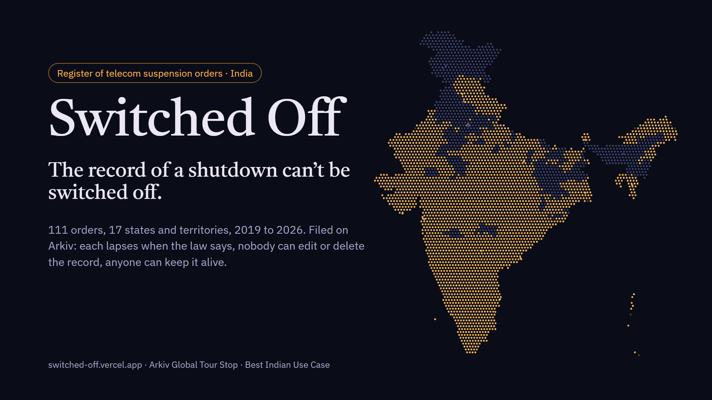

<p align="center"></p>

# Switched Off

[](https://github.com/RohanGlitched/switched-off/actions/workflows/ci.yml)
[](https://github.com/RohanGlitched/switched-off/actions/workflows/friction.yml)

**India's register of internet shutdowns, kept on Arkiv so that the record of a shutdown can't itself be switched off.**
A map of India at night where every district under a suspension order goes dark and relights at the block the order lapses;
187 sourced orders from 2019 to 2026 across 18 states and territories, sealed so that nobody (us included) can edit or delete
them and anyone can keep them alive; and one-tap "no internet here" reports from a throwaway browser key, with no sign-up and no
name. The whole site in Hindi or English; the report form also in Urdu, Bengali, Assamese, Punjabi and Odia.

**Live:** https://switched-off.vercel.app · **Proof:** [/proof](https://switched-off.vercel.app/proof) · **Mirror:** https://rohanglitched.github.io/switched-off/ ·
**Video (2:52):** https://youtu.be/W042WqAoYN0 · **Devfolio:** https://devfolio.co/projects/switched-off-e27e ·
Tracks: Arkiv Global Tour Stop, **Best Indian Use Case** and Censorship Resistance

## For judges: where everything is

| Requirement | Where | Note |
|---|---|---|
| Public deployment | https://switched-off.vercel.app | Also the [GitHub Pages mirror](https://rohanglitched.github.io/switched-off/) and a zero-dependency CLI ([`cli/`](cli/)), both reading Arkiv directly |
| Video, 3 min or less | https://youtu.be/W042WqAoYN0 | 2:52 |
| MIT licence | [`LICENSE`](LICENSE) | |
| `/arkiv/schema.md` | [`arkiv/schema.md`](arkiv/schema.md) | Entity types, attributes vs payload, lifetime per type, the operations that change it, exact queries |
| `/arkiv/friction.md` | [`arkiv/friction.md`](arkiv/friction.md) | 14 items ranked by cost, each with versions and a repro; `npm run friction` re-checks them and a [daily Action](.github/workflows/friction.yml) runs it |
| Reproducible steps and exact queries | [Run it](#run-it), [schema.md: Queries](arkiv/schema.md#queries-exact), [`arkiv/evidence.md`](arkiv/evidence.md#queries) | The [Data page](https://switched-off.vercel.app/data) prints every query the site sends; the register prints the query behind each filter |
| Tiramisu addresses that write entities | [`arkiv/wallets.md`](arkiv/wallets.md) | Registrar `0xA272…0E3e`, visitors' throwaway keys; the gas tap `0xFe54…6DF4` only sends GLM; `0x…dEaD` only owns |
| Work done 9–18 Oct only | [`docs/TIMELINE.md`](docs/TIMELINE.md) | No prior work. Baseline: the first commit, `254b8aa` (11 Oct), which holds what was built locally before it |
| Evidence that survives entity expiry | [`arkiv/evidence.md`](arkiv/evidence.md), [/proof](https://switched-off.vercel.app/proof) | Creation and batch transactions, an expired order read back with `atBlock`, the video |
| No real personal data on Arkiv | [schema.md: Personal data](arkiv/schema.md#personal-data-what-went-wrong-and-what-we-did) | We broke this on 11 Oct: 12 sealed entities quote a name from a public court record or article. Corrected, hidden by every reader, guarded against since; every key and its expiry is listed |
| Tests | [`test/`](test/), CI badge above | 294 unit tests, no network, including a docs check that every count above matches the register; CI runs them and the build on every push |
| 1. Why India? | [Who it's for](#who-its-for-and-what-changes-for-them-on-day-one), [/why](https://switched-off.vercel.app/why) | Sourced facts in [`research/facts.md`](research/facts.md) |
| 2. Why Arkiv? | [Why Arkiv](#why-arkiv-what-breaks-without-it), [Kept off Arkiv](#kept-off-arkiv-on-purpose) | Against Postgres, IPFS and a subgraph |
| 3. How we use Arkiv | [Every Arkiv feature](#every-arkiv-feature-and-what-the-user-sees), [/proof](https://switched-off.vercel.app/proof) | Seven live checks from your browser; the write checks are simulations, nothing is signed |
| 4. Friction report | [`arkiv/friction.md`](arkiv/friction.md) | Last full re-check 18 Oct, block 727,800: 25 checks still behave as documented, 3 changed |

## Who it's for, and what changes for them on day one

India led the world in internet shutdowns six years running (Access Now: 134, 121, 109, 106, 84 and 116 from 2018 to 2023), and
in 2021 Parliament's IT committee recommended a central database of every shutdown, with its duration, reasons and authority.
The Union government later told the committee it is "not aware of the number of internet shutdowns imposed by the States".
There is still no official register. Volunteer trackers such as SFLC.in's do careful work, on one team's server. Sources:
[`research/facts.md`](research/facts.md).

**What is on the register (18 Oct 2026).** 187 orders: 10 from 2019, 8 from 2020, 12 from 2021, 5 from 2022, 30 from 2023, 22 from 2024,
66 from 2025 and 34 from 2026 (SFLC's tracker counted 31 shutdowns in 2026 by mid-October; we count every renewal as its own order,
because each is a separate decision with its own deadline). 75 have the order text on file (marked published, or the order itself among their sources) and 18 are
recorded as never published; the rest cite reporting that quotes one. Every one carries its sources, and anyone can file the ones we are missing on [/file](https://switched-off.vercel.app/file).

| Who | Today | On Switched Off, from the first visit |
|---|---|---|
| People in a district that goes dark | Find out a shutdown is "official" from a forwarded photo of a letter, if at all | See whether an order exists, what it cuts, and the minute it lapses. With no order behind the outage, say "no internet here" in one tap; offline, the report waits on the phone and goes out late, marked late |
| Family and employers elsewhere | Can't tell a shutdown from a local fault when a call won't connect | The register says whether it is an order, and until when, and lets them report on their family's behalf |
| Lawyers, digital-rights groups, litigants | Challenging a shutdown starts with reconstructing the order, its stated reason and how often it was renewed | Each order carries its authority (a designation), stated reason, legal basis and sources, and every renewal links to the one before (`renews`, `seq`), so the count of renewals is a query, not a research project |
| Journalists | Cite a tracker they can't check | Every number on the site maps to a printed query and every order to a source link; every live change arrives with its block number |
| Courts and review committees | The 2024 Rules require orders to be published and reviewed; there is no public register of what was in force | A timestamped register of what was in force and when, which nobody can quietly edit |
| Anyone who wants the record kept | The record lasts as long as one team keeps its server | Anyone can extend a record ("Keep this record alive"), nobody can shorten or delete it, and the mirror and CLI read it with this site gone |

## Why Arkiv: what breaks without it

The register has two jobs: be the one record of a shutdown that can't be switched off, and run on the law's own clocks.
Each row is something it relies on.

| What the register relies on | Postgres behind our API | IPFS | A subgraph over a contract |
|---|---|---|---|
| Nobody can edit or delete a record, not even its filer (`readonly`, owner `0x…dEaD`) | The operator can, and can be pressed to; nobody outside can prove a row changed | A CID can't change, but the index of which CID is the current record lives on someone's server | Only if we write, audit and deploy a contract that forbids it |
| An order exists only while it is in force (expiry at the lapse block) | A cron job and the operator's honesty; the operator can stretch or cut it | No expiry: a lapsed order looks current forever | Contract storage doesn't expire; a keeper bot has to mark lapses |
| Anyone can keep a record alive, and nobody can shorten it (`permissionlessExtension`) | Only the operator pays to keep data | Anyone can pin, which IPFS does as well; but a pinned file can't be found by a question | Storage is permanent, so there is no lifetime to extend, and no expiry either |
| Typed queries that anyone can run on any endpoint, including at a past block (attributes, `atBlock`) | Only through our API, while it is up and unblocked | No queries: "what is in force in Manipur now?" has no answer | Through an indexer someone has to run and keep in sync |
| Who filed it is part of the record (`$creator`) | A column we write ourselves | Nothing, unless every file is signed | `msg.sender`, yes |
| Changes pushed live (entity events over WebSocket) | Our own socket server | Nothing | Whatever the indexer's host offers |

The best record today, SFLC.in's internetshutdowns.in, is careful work that still depends on one team, one database and one domain.
One blocking order under Section 69A takes a single-server register offline along with its evidence.

What Arkiv does not solve, and we say so on the [Why page](https://switched-off.vercel.app/why): Tiramisu is a testnet
with no durability promise yet; keys are free, so "confirmed by N keys" counts keys, not people; and anyone can write entities
tagged like ours, which the readers handle with the [trust rules](#trust-rules-what-readers-believe-and-what-they-dont).

### Kept off Arkiv on purpose

- **Who filed a report.** Reports are signed by a throwaway key generated in the browser. No name, phone number, Aadhaar or IP
  address is written; the forms and the writer refuse notes that look like one.
- **Exact locations.** District, never GPS: enough to light the map, too coarse to find a person.
- **People's names.** Authorities by designation, cases by court and date. Where we failed this, see
  [Personal data](arkiv/schema.md#personal-data-what-went-wrong-and-what-we-did).
- **The full text and PDF of each order.** A short paraphrase of the stated reason and links to where the government or the press
  published it.
- **The map, translations and site code.** Presentation, on a static host and in this repository; the data doesn't depend on them.
- **The relay's cache, the first-paint snapshot and the gas tap.** Conveniences on our server. `public/snapshot.json` is a copy of
  the sealed archive as Arkiv returned it at one block, shown labelled with that block for the second or two until the live read
  replaces it. Direct mode, the mirror and the CLI use none of them.

## Every Arkiv feature and what the user sees

| Arkiv feature | What the user sees | Code |
|---|---|---|
| Expiration | A district relights at the block its order's legal deadline falls on, with no server deciding; an unconfirmed emergency order dies 24 h after issue; a report fades after 6 h | `fileOrder`, `lapseOf`, `fileReport` in [`src/lib/write.ts`](src/lib/write.ts) |
| Lifetime extension | "Still down here: confirm" on someone's report (anyone, once per key) and "Confirm this emergency order" (its filer only); "Keep this record alive another year" (anyone); "confirmed by N keys", counted from the extension transactions | `confirmReport`, `confirmEmergency`, `keepAlive` in [`src/lib/write.ts`](src/lib/write.ts); `extenders` in [`src/lib/arkiv.ts`](src/lib/arkiv.ts) |
| Creation flags | Records and reports are `readonly` + `permissionlessExtension`, orders `readonly`; the flags are printed on every entity page | `fileReport`, `fileOrder` in [`src/lib/write.ts`](src/lib/write.ts) |
| Ownership transfer | "Sealed" on every gazette and entity page: nobody can delete, shorten or hand on the record | `fileOrder` (`ownershipChanges`, keys from `predictEntityKeys`) in [`src/lib/write.ts`](src/lib/write.ts); [`scripts/seal.ts`](scripts/seal.ts) |
| Batch writes | An order and its permanent record land together or not at all, already sealed; the 111-record archive went in 12 transactions | `fileOrder` in [`src/lib/write.ts`](src/lib/write.ts); [`scripts/seed-archive.ts`](scripts/seed-archive.ts), [`scripts/correct-names.ts`](scripts/correct-names.ts) |
| Attributes vs payload | Filters by state, scope and date run on Arkiv; the reason, authority and sources ride in the payload and print on the gazette page | `orderAttrs`, `orderPayload` in [`src/lib/write.ts`](src/lib/write.ts); [`arkiv/schema.md`](arkiv/schema.md) |
| Queries | The register's state and "issued since" filters run as typed equality and `u64` range queries, with the exact query printed under the list; pages of 200 walked by cursor | `recordsWhere`, `reportsSince`, `pages` in [`src/lib/arkiv.ts`](src/lib/arkiv.ts) |
| `$creator` / `$owner` | "Filed by the registrar" or "community transcription"; a stranger's correction can't hide a record; junk in the namespace can't bury the archive, which is read by its author | `recordsOfficialAndCommunity`, `trustedCorrection`, `withinLawCap` in [`src/lib/arkiv.ts`](src/lib/arkiv.ts) |
| `atBlock` | The drill's rewind slider, the CLI's `at <block>`, and the lapsed order on /proof read back at its own block | `activeOrders` in [`src/lib/arkiv.ts`](src/lib/arkiv.ts); [`src/pages/Drill.tsx`](src/pages/Drill.tsx); [`cli/switched-off.mjs`](cli/switched-off.mjs) |
| WebSocket entity events | The live wire shows a filing, report or confirmation within seconds, and the map re-reads; if the socket can't open, the relay is polled | `watchEntityEvents` in [`src/lib/store.ts`](src/lib/store.ts); `eventsClient` in [`src/lib/arkiv.ts`](src/lib/arkiv.ts) |
| Delete | "Withdraw my report" on your own reports; nobody can delete a sealed record | `withdrawReport` in [`src/lib/write.ts`](src/lib/write.ts) |

Each of these is checked against the network on [/proof](https://switched-off.vercel.app/proof) or tied to a transaction in
[`arkiv/evidence.md`](arkiv/evidence.md).

## How the law becomes the database

| The rule (Telecommunications (Temporary Suspension of Services) Rules, 2024) | On Arkiv |
|---|---|
| An order runs for a specified duration, at most 15 days | The `order` entity expires at its lapse block; nothing can stretch it. A renewal is a new entity linked with `renews` and `seq`, so every renewal is counted |
| An emergency order lapses in 24 hours unless confirmed | Filed to expire 24 h after issue; confirming it is extending it, and only the filer's key can |
| Orders must be published, with reasons | Readonly entities with the stated reason and sources; a correction is a new entity |
| (no rule) The record should outlive the order | A `record` written in the same batch, readonly, that anyone may extend |
| (citizens) "It's dark here" | A `report` that lives 6 h and that anyone may extend (confirm) but nobody may edit |

## What it does

- **A live map of India at night.** About 4,000 lights, one cluster per district. A suspension order in force switches its
  districts off. A district people report as dark with no published order behind it burns red.
- **The register.** 187 sourced orders from 2019 to 2026 (111 imported on 11 Oct; 76 more from 2025–26 researched and added on 18 Oct, and 36 registrar corrections from better sources) (Manipur, Jammu and Kashmir, Haryana, Punjab, Rajasthan, Delhi and
  more), each printed as a page of the Gazette with its authority, stated reason, renewal chain and sources.
- **Reports from the ground.** No sign-up, no name, a throwaway key in the browser. Reports fade in six hours unless a neighbour
  confirms them. Made offline, they wait on the phone and go out when the signal returns, marked late.
- **A drill.** The same rules at one legal day per minute: issue an order, watch its districts go dark and relight on time,
  watch an unconfirmed emergency order die after a day, rewind to any past block.
- **Play the history.** Replay every order on file from 2019 to today on the map.
- **Anyone can file.** A form for transcribing a published order (source link required, designations not names), labelled as a
  community transcription, and sealed in the transaction that creates it.
- **Proof.** Seven buttons that ask Arkiv, from your browser, whether the site's claims hold right now.
- **Can't be switched off.** A one-file mirror, an independent GitHub Pages copy and a zero-dependency CLI all read Arkiv
  directly, and take any Arkiv endpoint. Block this site and the register is still there.

## Trust rules (what readers believe, and what they don't)

Arkiv has no schema owner: anyone can write an entity tagged like ours. The readers (site, mirror, CLI) defend themselves, and
say so on the Why page:

- **A correction hides a record only if it comes from the registrar or from the record's own filer** (`$creator`). A stranger's
  "correction" is shown as what it is: another entity.
- **A community order darkens the map only within the law's fifteen-day cap.** Anyone can file an order; one dated years ahead
  stays in the register as a community transcription but can't switch a district off.
- **An order filed on the site is sealed in the same transaction that creates it** (its keys are predicted from the entity nonce),
  so not even its filer can stretch, cut or delete it. Emergency orders stay with their filer, because confirming one is an extension.
- **A report's filer can withdraw it** (delete is the one thing an owner of a readonly entity can still do); nobody can delete a
  sealed record, because nobody owns it.
- **"Confirmed by N keys" counts keys, not people.** Keys are free, so the count is a signal, not proof.
- **Nobody is named.** A guard refuses phone numbers, emails, Aadhaar numbers, honorifics, case titles, judge styles, names the
  register has already had to remove, and links whose slug carries a name, before any write (`src/lib/pii.ts`, checked against
  every archive record by `scripts/pii-check.ts`). It came after a mistake we can't undo:
  [Personal data](arkiv/schema.md#personal-data-what-went-wrong-and-what-we-did).
- **The archive is read by its author.** The registrar's records are read with `$creator`, so no amount of junk written into the
  namespace can bury them or make a page read thousands of entities; community records are read with a page cap and labelled.
- **A hostile entity can't take the page down.** Every payload field is typed and capped before it reaches a component, and
  each page and card sits in its own error boundary.
- **Reads survive the relay.** Reads go through our relay by default (Arkiv meters keyless reads) and fall back to Arkiv
  directly, and the other way round in direct mode. The relay forwards only simple AND queries with the app clause in front, never
  sees a key of yours, and serves its last good answer for up to fifteen minutes when every path refuses. When a read still fails,
  the banner shows the reason.

What was hard, with versions and reproductions: [`arkiv/friction.md`](arkiv/friction.md).

## Run it

```bash
npm install
cp .env.example .env.local   # FAUCET_KEY, ARKIV_KEY (optional for reading)
npm run dev                  # http://localhost:5190
```

Read the register without the site:

```bash
node cli/switched-off.mjs active      # orders in force now
node cli/switched-off.mjs state MN    # every order on file for Manipur
node cli/switched-off.mjs reports     # live citizen reports
```

Rebuild the archive import (needs a funded key in `.env.local`): `npx tsx scripts/seed-archive.ts --dry`, then without `--dry`.
Rebuild the map: `python scripts/build-map.py` (Datameet shapefiles, see credits).
Re-check the friction report: `npm run friction` (read-only, no key, about 10 keyless requests).

### Tests

`npm test` runs the unit suite in `test/` (Vitest, no network, nothing written to Arkiv); CI runs it and the build on every push.

- **Personal-data guard:** phone numbers in every spacing, `+91`, Devanagari and full-width digits, Aadhaar, emails written out
  ("name at gmail dot com"), UPI ids, honorifics, case titles and names in link slugs are caught; districts, carriers, dates
  and order numbers pass, and so does every field and link of the archive import.
- **Trust rules:** a stranger's correction can't hide a registrar record (the registrar's or the original filer's can), renewal
  chains stay on one desk, and a community order darkens the map only within the law's cap.
- **Hostile entities:** wrong types, huge strings, non-array districts, payloads that throw and `javascript:` source links all
  come out as safe, capped values.
- **The relay:** every query the app builds with the SDK is captured and passes the relay's grammar; OR, NOT, brackets, stray
  quotes, `*`, over-long queries, bad limits, unknown options and other contracts' logs are refused and never forwarded.
- **Lifetimes and the offline queue:** the 15-day cap, the 24-hour emergency lapse and the 6-hour report in whole 2-second
  blocks, rounded up; queued reports keep the time they were seen, go out late, once, and survive a dropped connection.

## Reproducible evidence

- Every address that writes entities, with its role: [`arkiv/wallets.md`](arkiv/wallets.md). The registrar,
  `0xA2724EA69eA093677D8426E7FE20644EE90a0E3e`, filed the archive in 12 batch transactions on 11 Oct 2026 (keys in
  `scripts/seeded.json`).
- Each Arkiv feature with a transaction or entity and a command to re-check it: [`arkiv/evidence.md`](arkiv/evidence.md).
- Every number on the site maps to a query listed on the [Data page](https://switched-off.vercel.app/data) and in `arkiv/schema.md`.

## Built 9–18 October 2026

All code, data and design were made between 9 and 18 October 2026 for the Arkiv Global Tour Stop. There is no prior work; the
baseline is the first commit, `254b8aa` (11 Oct). Day by day, with the chain's timestamps: [`docs/TIMELINE.md`](docs/TIMELINE.md).
Libraries: React, Vite, viem, `@arkiv-network/sdk` 0.8.1.

## Credits and sources

- District boundaries: [Datameet](https://github.com/datameet/maps) Census 2011 districts, CC BY 2.5 India. India outline: Datameet `india-composite`, CC0.
- Every order carries its own sources; the research notes are in [`research/`](research/). Headline facts: Access Now #KeepItOn,
  SFLC.in, the Supreme Court in *Anuradha Bhasin v. Union of India* (2020), the Parliamentary Standing Committee on Communications
  and IT (26th Report, 2021), Top10VPN, ICRIER.

MIT licensed.
